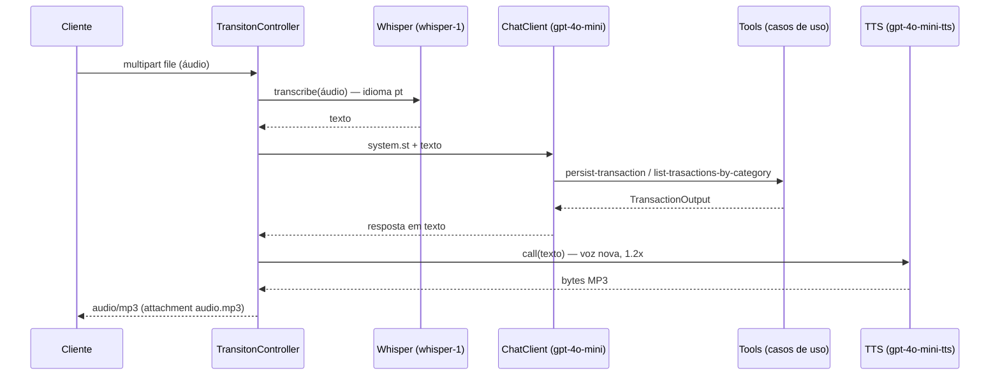

# Arquitetura

## Camadas

```mermaid
flowchart TD
    subgraph infrastructer
        HTTP[TransitonController<br/>/transactions]
        JPA[JpaTransactionRepository]
        ER[TransactionEntityRepository<br/>CrudRepository]
        ENT[TransactionEntity @Entity]
    end
    subgraph aplication
        P[PersistTransactionUseCase<br/>@Tool persist-transaction]
        L[ListTransactionByCategoryUseCase<br/>@Tool list-trasactions-by-category]
    end
    subgraph domain
        T[Transaction / TransactionId]
        C[Category]
        R[TransactionRepository]
    end
    HTTP --> P & L
    P & L --> R
    JPA -.implementa.-> R
    JPA --> ER --> ENT
    ER --> DB[(MySQL)]
```

- O **domínio** não importa Spring Data nem Web; a infraestrutura converte `Transaction` ↔ `TransactionEntity`.
- Os **controllers de IA** (`/api/*`) ficam no pacote raiz e falam direto com os modelos, fora das camadas.

## Fluxo do assistente por voz (`POST /transactions/ai`)



## Tratamento de erros

Não há `@ControllerAdvice` nem validação (`@Valid`): uma categoria inválida no caminho ou no JSON gera o erro padrão do Spring (400), e falhas da OpenAI ou do banco viram 500.
